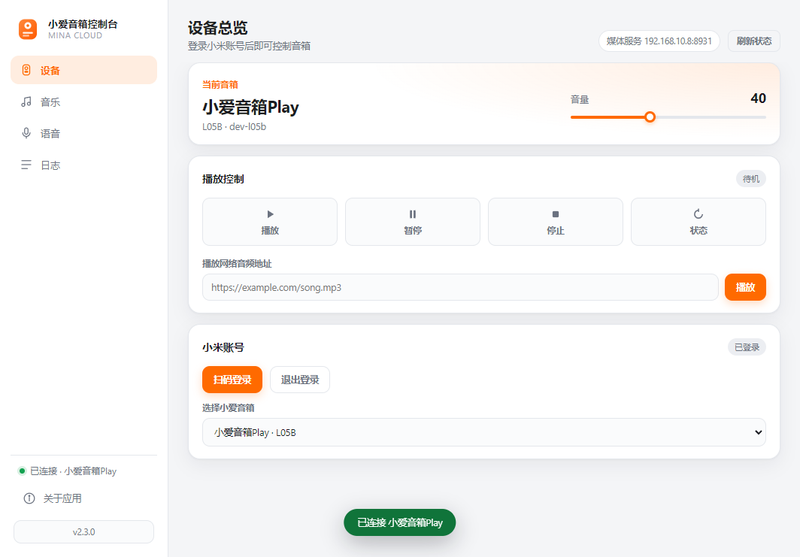
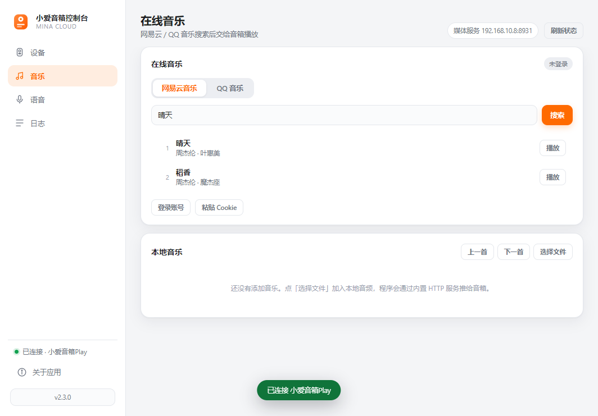
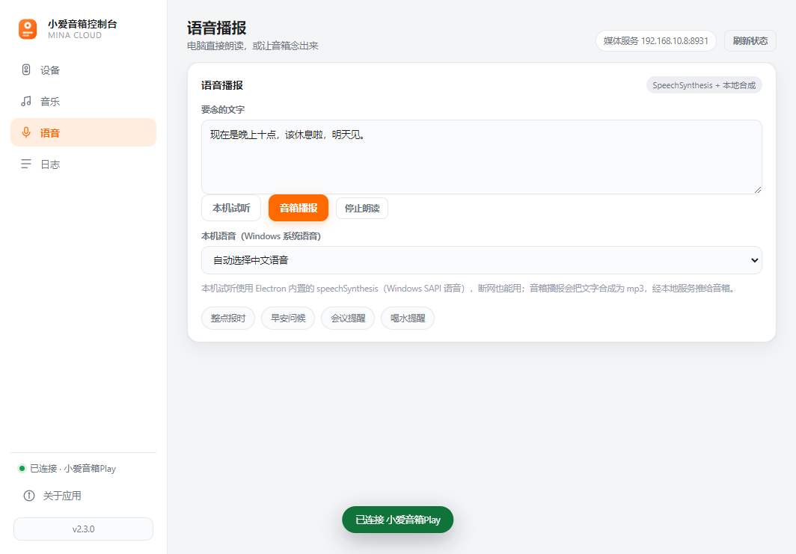
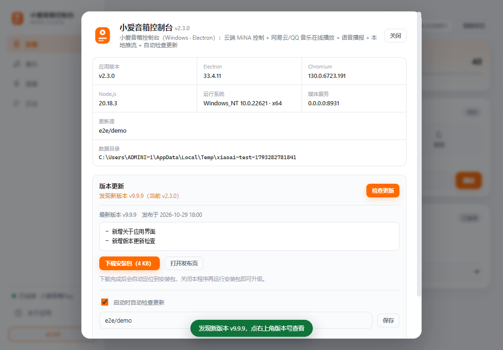

<div align="center">


# 小爱音箱控制台

**Windows 桌面端的小爱音箱遥控器 · Electron + JavaScript**

[](https://github.com/nieshilin/xiaoai-speaker-controller/releases)
[](https://github.com/nieshilin/xiaoai-speaker-controller)
[](https://www.electronjs.org/)
[](LICENSE)

走小米 **MiNA 云端通道**下发指令，音箱无需开端口、无需 token；
支持**网易云音乐 / QQ 音乐在线搜索播放**、**本地音乐局域网推流**、**语音播报**，
并通过 **GitHub Releases 自动检查更新**。

[下载安装包](https://github.com/nieshilin/xiaoai-speaker-controller/releases) · [功能特性](#-功能特性) · [快速开始](#-快速开始) · [常见问题](#-常见问题)

</div>

---

## 📸 界面预览

| 设备总览 | 在线音乐 |
| :---: | :---: |
|  |  |
| **语音播报** | **关于 / 检查更新** |
|  |  |

## ✨ 功能特性

### 🔐 小米账号
- **扫码登录**：米家 App 扫码确认即可，全程不输密码；登录态（passToken）保存在本机，之后启动**自动续期**，无需重复登录
- **多设备支持**：账号下所有小爱音箱自动出现在下拉框，一键切换

### 🎵 在线音乐（双音源）
- **网易云音乐 / QQ 音乐**任意切换搜索，点歌曲直接让音箱播放
- **内嵌登录窗口**：点「登录账号」弹出内置浏览器，扫码 / 账密登录后**自动提取 Cookie**（含 QQ 音乐 `qm_keyst` 播放凭证的自动唤醒），也可手动粘贴 Cookie
- **音源本地代理**：歌曲不直接把平台 CDN 直链丢给音箱，而是经内置媒体服务 `/proxy/<音源>/<id>` 中转——电脑带正确 UA / Referer 取流，规避音箱拉不到 CDN、vkey 失效、UA 拦截等问题；下发前还会**探测直链可用性**，杜绝死链
- VIP / 版权歌曲自动识别，未登录时给出明确提示

### 💽 本地音乐
- 内置 HTTP 媒体服务（支持 `Range` 206 分段），把本地 mp3 / flac / wav / m4a / ogg 等推流给音箱
- 播放列表 + 上一首 / 下一首

### 🗣️ 语音播报（TTS）
- **本机试听**：渲染进程直接调用 Chromium 内置 `speechSynthesis`（Windows SAPI 系统语音），**断网也能用**，可选中文语音
- **音箱播报**：把文字合成为 mp3（自动分段、自动重试），经本地服务推给音箱出声；L05B / L05C / LX04 等型号自动走音频通道，支持云端 TTS 的型号优先走云端

### 🎛️ 播放控制
- 播放 / 暂停 / 停止 / 状态查询 / 音量滑块（自动回读设备音量）
- 播放任意网络音频地址
- **型号自适应**：L05B/L05C/LX04/LX05 等自动改用 `player_play_music` 下发，其余走 `player_play_url`

### 🔄 版本更新
- 启动自动检查 GitHub Releases（**公开仓库匿名访问，无需 Token**），发现新版右上角亮红点
- 关于面板内查看更新说明、下载安装包（重定向跟随 + 实时进度），或一键打开发布页

## 🚀 快速开始

### 方式一：下载安装包（推荐）

到 [Releases](https://github.com/nieshilin/xiaoai-speaker-controller/releases) 下载 `XiaoAiSpeakerControl Setup x.x.x.exe`，双击安装即可。

### 方式二：源码运行

```powershell
git clone https://github.com/nieshilin/xiaoai-speaker-controller.git
cd xiaoai-speaker-controller
npm install
npm start
```

> 国内网络如 Electron 二进制下载失败：`$env:ELECTRON_MIRROR="https://npmmirror.com/mirrors/electron/"` 后再 `npm install`

### 使用步骤

1. 首次使用点 **「扫码登录」**，用米家 App 扫码并确认
2. 下拉框选择音箱，左下角状态灯变绿
3. 在 **「音乐」** 页搜索歌曲，点「播放」即从音箱出声
4. 播放**本地文件**时，音箱通过 `http://<电脑IP>:8931` 拉流；首次失败请在 Windows 防火墙放行本程序的 **「专用网络」** 入站

### 开发与测试

```powershell
npm start        # 启动
npm run check    # 离线自检（40 项）
npm run e2e      # 端到端 UI 测试（21 项，模拟小米云端）
npm run icon     # 重新生成应用图标（build/icon.ico）
npm run dist     # 打包 Windows 安装包（输出 release/）
```

## 🧱 项目结构

```
main.js                Electron 主进程：窗口、IPC、账号与音源编排、更新检查
preload.js             contextBridge 桥接（渲染层只暴露 window.api）
src/mina.js            小米账号扫码登录 + passToken 续期 + MiNA ubus 指令
src/music.js           网易云 / QQ 音乐：搜索、取播放地址、登录态判定
src/musicCookie.js     Cookie 域名过滤 / 择优 / 规范化校验
src/mediaServer.js     本地媒体服务：文件推流 + 音源代理（Range 206）
src/speech.js          语音合成：分段、重试、mp3 落盘
src/updater.js         GitHub Releases 版本比较 / 资源挑选 / 安装包下载
src/store.js           本机配置读写
renderer/              界面（侧边导航四视图 + 关于弹窗）
scripts/selfcheck.js   离线自检
scripts/e2e.js         端到端测试
scripts/fakeCloud.js   模拟小米云端 / 音乐平台 / GitHub API
scripts/make-icon.js   应用图标生成
```

## ❓ 常见问题

<details>
<summary><b>音箱不出声，日志提示「音箱未进入播放态」</b></summary>

音箱和电脑必须在**同一局域网**，且 Windows 防火墙需放行本程序的**专用网络**入站（8931 端口）。日志里能看到音箱是否来拉流。
</details>

<details>
<summary><b>在线歌曲播放失败 / 提示需要会员</b></summary>

版权 / VIP 歌曲需要登录对应平台账号：点「登录账号」在内嵌窗口登录，或「粘贴 Cookie」手动保存（网易云需含 <code>MUSIC_U</code>，QQ 音乐需含 <code>uin</code> 和 <code>qm_keyst</code>）。QQ 音乐会员曲目还需要账号本身有会员权益。
</details>

<details>
<summary><b>语音播报没声音</b></summary>

音箱播报会把文字合成为 mp3 经本地服务推送，同样依赖局域网与防火墙放行；L05B 等型号不支持小米云端 TTS，程序已自动改走音频通道。可以用「本机试听」先在电脑上听效果（走 Windows 系统语音，断网可用）。
</details>

<details>
<summary><b>检查更新提示仓库不存在</b></summary>

更新检查走 GitHub 公开接口，仓库必须为公开仓库。可在关于面板里修改「更新源」（格式 <code>owner/repo</code>）。
</details>

<details>
<summary><b>扫码换 serviceToken 失败（401）</b></summary>

小米返回的 <code>nonce</code> 是 19 位大整数，<code>JSON.parse</code> 会丢精度导致签名错误；<code>src/mina.js</code> 已做保精度处理并在自检里加了回归用例，改动时不要去掉。
</details>

<details>
<summary><b>登录态失效了</b></summary>

重新扫码即可。小米 passToken 长期有效，一般很少遇到。
</details>

## ⭐ Star History

如果这个项目对你有帮助，欢迎点个 Star！

---

<div align="center">

**音乐音源由网易云音乐 / QQ 音乐提供，本工具仅作播放控制，请支持正版。**

Made with ❤️ by [nieshilin](https://github.com/nieshilin) · License [MIT](LICENSE)

</div>
